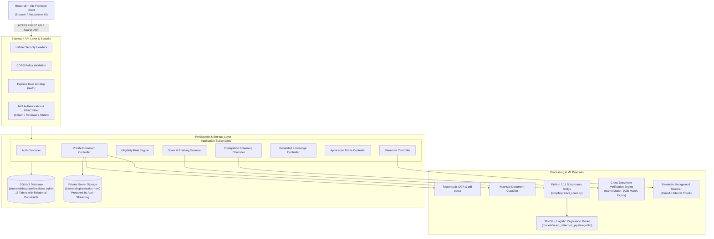

# System Architecture Specification

## 1. High-Level Architectural Diagram

## 2. Component Responsibilities

### 2.1 Frontend Presentation Tier (React + Vite)
- **`AuthContext.jsx`:** Manages client-side token lifecycle (`localStorage`), decodes user profile, handles login/registration/logout, and provides `hasRole()` guard.
- **`ProtectedRoute.jsx`:** Enforces authentication and role verification before rendering sensitive views, redirecting unauthorized users.
- **`api.js`:** Axios instance configured with request interceptors to automatically attach `Bearer <token>` headers and response interceptors to catch HTTP 401 exceptions.
- **Page Components:**
  - `Dashboard.jsx`: Primary navigational entrypoint highlighting all operational subsystems.
  - `Services.jsx`: Government service directory and requirement inspectability.
  - `DocumentUpload.jsx`: Private document vault, OCR preview, and user field confirmation.
  - `Eligibility.jsx`: Interactive rule verification engine with criteria breakdown.
  - `Checklist.jsx`: Service checklist with SQLite database synchronization.
  - `ScamVerification.jsx`: Real-time ML inference and heuristic signal assessment.
  - `ImmigrationCases.jsx`: Case registry with reviewer workstation banners.
  - `ImmigrationCaseDetail.jsx`: Case investigation dashboard, document pairing, discrepancy flags, and decision audit logs.
  - `KnowledgeBase.jsx`: Verified gazette articles directory and grounded QA assistant.
  - `ApplicationDrafts.jsx`: Application builder with verified OCR autofill and statement generator.
  - `RemindersPage.jsx`: Expiration tracking and due date countdowns.
  - `Login.jsx` & `Register.jsx`: Credential authentication forms with quick test account selection.

### 2.2 Backend Application Tier (Node.js & Express)
- **`server.js`:** Mounts security middleware (Helmet, CORS, Rate Limiters), defines route endpoints, runs initial migrations safely without dropping data, and boots the background scheduler.
- **`authMiddleware.js`:** Verifies cryptographic signature and expiration of JWT tokens. Explicitly rejects hardcoded demo tokens (`demo-token`) and checks role permissions against database user records.
- **`ocrService.js`:** Extracts raw digital text from uploaded files using Tesseract.js for raster images and `pdf-parse` for digital PDFs.
- **`documentClassifier.js`:** Applies rule-based pattern matching and regular expressions to extract structured fields (Passport numbers, Aadhaar numbers, PAN, DOB, Expiry, Names).
- **`immigrationVerificationService.js`:** Analyzes paired identity documents, computing name token overlap similarity, parsing date strings, checking past expirations, and raising structured security flags.
- **`reminderScheduler.js`:** Executes background interval scans querying due reminders in SQLite without duplicate alert spamming.

### 2.3 Machine Learning & Data Tier (Python 3.11 & Scikit-learn)
- **`scripts/acquire_and_prepare_dataset.py`:** Automates download of the UCI SMS Spam Collection, enriches with domain-adapted synthetic Indian government scam lures, removes duplicates, and generates `data/processed/combined_spam_dataset.csv`.
- **`scripts/train_scam_model.py`:** Evaluates TF-IDF + Multinomial Naive Bayes versus TF-IDF + Logistic Regression across an 80/20 stratified split (1,036 test samples). Saves best model to `models/scam_detection_pipeline.joblib`.
- **`scripts/predict_scam.py`:** Bridge script receiving input text, generating model predictions and probabilities, and returning structured JSON to the Node.js backend.
