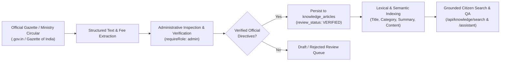

# Official Data Pipeline & Verification Workflow

## 1. Official Knowledge Ingestion Pipeline

To prevent hallucinated government requirements, fees, and deadlines, the system employs a verified gazette pipeline:

---

## 2. Source Credibility Hierarchy

The system strictly ranks source authority:
1. **Tier 1 — Statutory Gazettes & Ministry Portals:** E.g., `uidai.gov.in`, `incometax.gov.in`, `passportindia.gov.in`, `scholarships.gov.in`.
2. **Tier 2 — State Directorate Orders:** Circulars published by state transport departments, university boards, or revenue offices.
3. **Tier 3 — Academic Demonstrations & Synthetic Fixtures:** Clearly tagged with `is_synthetic = 1` in the database to prevent student examples from being represented as official statutory policies.

---

## 3. Administrative Re-Indexing & Article Life Cycle

1. **Publication:** Only accounts holding the `admin` role can post new records via `POST /api/knowledge/articles`.
2. **Attribution Constraints:** Every article must include an active `official_portal` domain, a direct `source_url`, and the `verification_date` when the directive was last checked against the central gazette.
3. **Modification & Deletion:** Outdated gazette rules can be deleted or updated through `DELETE /api/knowledge/articles/:id`.
4. **Grounded Synthesis:** The QA assistant (`POST /api/knowledge/assistant`) operates exclusively over verified records. If no matching verified article exists, the system outputs an honest refusal rather than fabricating rules or phone numbers.
