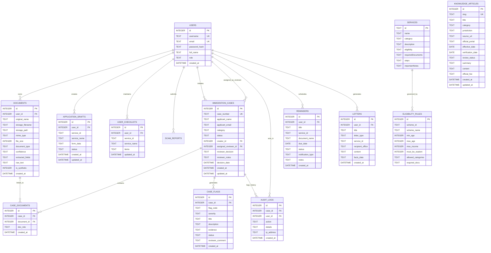

# Database Schema & Entity-Relationship Specification

## 1. Entity-Relationship Diagram

## 2. Table Definitions & Constraints

### `users`
- Stores registered user identities, password hashes, and access roles.
- `role`: Constrained to `'citizen'`, `'reviewer'`, or `'admin'`.
- Passwords are salted and hashed with `bcryptjs` (10 rounds); plaintext passwords are never stored.

### `documents`
- Represents files uploaded to the private server vault.
- `storage_filename`: Server-generated unique name (`doc-<timestamp>-<random>.ext`), preventing path traversal and name collision.
- `user_id`: Foreign key enforcing data isolation.
- `extracted_fields`: JSON string containing extracted key-value pairs (e.g. Passport number, DOB, Name).

### `immigration_cases`
- Core screening dossiers.
- `status`: `'PENDING_REVIEW'`, `'UNDER_REVIEW'`, `'APPROVED'`, `'REJECTED'`, `'REQUIRES_MORE_INFO'`.
- `case_number`: Unique identifier formatted as `CASE-YYYY-XXXXXX`.

### `case_flags`
- Discrepancies and anomaly findings generated by automated cross-document screening.
- `severity`: `'LOW'`, `'MEDIUM'`, `'HIGH'`, `'CRITICAL'`.
- `status`: `'ACTIVE'`, `'DISMISSED'`, `'RESOLVED'`.

### `audit_logs`
- Append-only security audit log recording case creation, document linkage, screening runs, flag overrides, and reviewer decisions with actor ID, timestamp, and IP address.

### `user_checklists`
- Persists user document preparation progress per government service.
- Unique constraint on `(user_id, service_id)` ensures idempotent progress saving.

### `reminders`
- Renewal and deadline records evaluated periodically by `reminderScheduler.js`.
